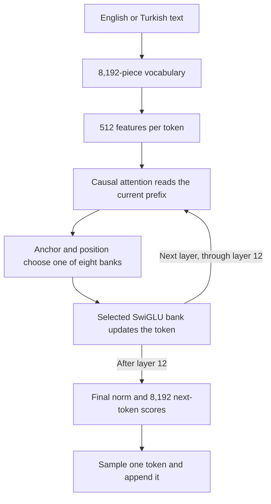
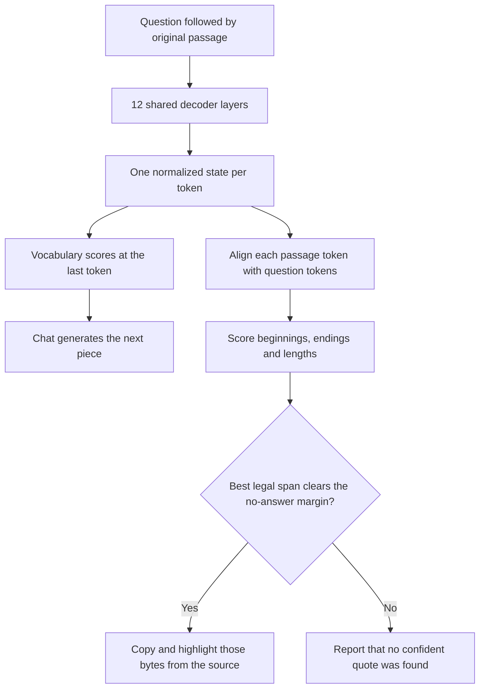

# How Franok predicts the next token

Franok is a decoder-only language model for English and Turkish. Its anchor-rotation rule assigns work to eight independent SwiGLU networks at each of twelve layers. It uses a byte-level bilingual vocabulary fitted from scratch, grouped-query attention, rotary position embeddings, RMS normalization and tied input/output embeddings.

A sentence first becomes a list of token IDs. For each new token, attention reads the earlier context. A routing rule chooses which bank of learned weights processes the result. After twelve layers, Franok scores the possible next tokens and the decoder picks one.

## Trace one token

Suppose the previous group ends in token ID **17**. Follow slot **3** in layer **2**, counting from zero. Shift 17 right by two bits to get 4. Add the layer number to get rotation 6. Slot 3 then visits bank **(3 + 6) mod 8 = 1**. Its neighbor in slot 4 visits bank 2. Each of the other slots follows the same rotation. Attention still reads earlier positions on every layer. The banks change which feed-forward weights update each position.

[Watch the two-minute film on YouTube](https://youtu.be/XtNThi_pBjM) · [Download the film](../web/media/franok-from-scratch.mp4) · [Move the routing controls](https://franok.yunusemrevurgun.com/#about) · [Training stages and equations](training.md)

In the interactive diagram, select a token and choose **Predict the next piece**. The app sends the prefix through the local decoder, shows the five most likely pieces and reports the probability Franok assigned to the actual next piece in your example. It uses the raw softmax over all 8,192 vocabulary entries. For example, assigning probability 0.25 to the observed piece gives a next-token loss of $-\ln(0.25)\approx 1.386$ nats. Each prediction uses the installed Q4 or Q8 weights, and editing the sentence changes the measured distribution. Chat additionally uses role markers, a system prompt and sampling controls.

## Routing

Number layers and positions from zero. For position $t$, let $g=\lfloor t/8\rfloor$ and $s=t\bmod 8$. Define $a_g=0$ for the first group and $a_g=x_{8g-1}$ for later groups, where $x$ is the input token ID. Layer $l$ chooses

$$b(l,t)=\left[s+l+\left\lfloor a_g/2^{l\bmod4}\right\rfloor\right]\bmod8.$$

The anchor always precedes the group. Adding a constant modulo eight permutes its eight slots, so every complete group assigns exactly one token to each bank. This holds for repeated tokens and for either language. All assignments can be calculated before the first layer. Training gathers positions in bank order, computes two batched matrix products, and restores sequence order. In autoregressive decoding a token reads only its assigned bank. A partial last group uses a subset. Right-padding to eight in the reference forward pass has no effect on earlier logits.

The dependence on the previous group's last token and the fixed cyclic permutation are the design choices specific to this implementation. Content-based deterministic expert selection and balanced expert training have prior art. The permutation trades content-adaptive specialization for predictable load. [Hash Layers](https://arxiv.org/abs/2106.04426) · [BASE Layers](https://arxiv.org/abs/2103.16716)

## Decoder

Write $R(x)=g\odot x / \sqrt{\operatorname{mean}(x^2)+10^{-5}}$. Each block first computes $u=R(x)$ and projects $u$ into eight query heads and two key/value heads of dimension 64. Four query heads share each KV head. Rotary embeddings rotate adjacent component pairs by angle $t/10000^{2j/64}$. For each head, multiply the softmax of causally masked $QK^T/8$ by $V$. Concatenate heads, project, and add the residual to produce $z$.

For bank $b(l,t)$, the second sublayer is

$$x'=z+W_{d,b}\Big(\operatorname{SiLU}(W_{a,b}R(z))\odot W_{g,b}R(z)\Big).$$

Each bank expands 512 features into 2,048. All projections omit bias. The final norm and token embedding transpose yield 8,192 logits. Pretraining minimizes mean next-token cross entropy. The final supervised stage masks prompt tokens and padding.

| Component | Parameter count |
|---|---:|
| Tied token embeddings | 4,194,304 |
| Attention projections in 12 layers | 7,864,320 |
| Feed-forward banks in 12 layers | 301,989,888 |
| 25 RMS scale vectors | 12,800 |
| **Total** | **314,061,312** |
| **Parameters on one token's path, including the vocabulary head** | **49,820,160** |

The extended release trains up to 1,024 positions. The first release trained to 256. The application keeps complete saved sessions, retrieves earlier messages by term overlap weighted by inverse document frequency, and fits them into the space left by the current question and system instructions. Search returns the original saved turn and lets the user attach it to a new message. An attachment gets prompt budget first and its local citation survives a restart. A long attachment includes the passage around the search match. Recent turns stay complete whenever there is room. A long reply keeps its beginning and ending, and its citation is marked as an excerpt. The source turn stays available in full. This application feature can retrieve text older than the neural window. Approximate keyword retrieval can miss paraphrases.

### How a passage can supply an exact answer

The experimental passage reader shares the trained bilingual decoder. Chat uses its last state to predict another token. The reader also retains the normalized state at every position, including positions inside the source. It compares each source token with the question words and lets nearby tokens on either side help identify answer boundaries.

For question keys $k_j$ and a passage query $p_i$, the alignment weights are $a_{ij}=\mathrm{softmax}_j(p_i^\top k_j/\sqrt{96})$. The head combines the aligned question vector with the decoder state, then applies short depthwise convolutions and a residual projection. A span starting at $i$ and ending at $j$ receives $s_i+e_j+\ell_{j,j-i}$. Candidate spans cover up to 48 tokens. Both byte boundaries must be valid UTF-8 character boundaries. A separate learned score represents an unanswerable question. The reported quote always comes from the original text. Selecting the right quote is a learned skill and can fail. [PyTorch readout](../franok/span.py) · [Browser readout](../web/reader.mjs)

### Finding an exact quote in a long chat

Type `/recall train` or `/hatırla tren` in the workspace to quote your earlier messages containing that word. The application returns excerpts with links to their original turns. This search runs on the device and can reach a turn outside the last 1,024 model tokens. When you attach a turn to a new question, the neural model still has to interpret it.

## What happens after you press Send

On the first pass, Franok reads the prompt and saves two small vectors per key/value head at each position in each layer. A key helps a later token find relevant earlier words. A value carries information from the word it belongs to. When Franok writes its next token, it reuses those saved vectors, adds the new token's vectors, and evaluates the one bank assigned to that token. It repeats until it produces the stop token or reaches the reply limit.

The browser, Ubuntu app and Python chat command all reuse these attention values while writing a reply. The Python reference checks the cached result against a full causal pass at every generated position, including both sides of a routing-group boundary. [PyTorch decoder](../franok/incremental.py) · [Parity check](../tests/incremental.py)

## Browser implementation

The worker streams one checked weight file, verifies SHA-256, and reuses a cached copy where available. In the original peak-scale Q4 exporter, each group of 32 weights has a float32 scale $s=\max(|w|)/7$ and sixteen bytes of packed integer weights. Entries $j$ and $j+16$ share a byte. Each group therefore uses 20 bytes. The WebAssembly SIMD kernel quantizes input activations to signed eight-bit values per group, forms integer dot products and accumulates the rescaled products in float32. Norm scales and KV caches stay in float32. The released Q4 exporter tries several scale seeds and alternates code assignment with a least-squares scale fit, keeping the lowest squared reconstruction error for each group. Q8 stores 32 signed bytes and a float32 scale per group. Its integer limit is 127. At 1,024 tokens the twelve-layer key/value cache occupies 12 MiB. First-generation latency includes prompt processing. Device throughput varies.

The reference parity check compares every position of a small deterministic PyTorch example with the incremental WASM decoder, including anchor changes and partial groups. The bilingual tokenizer round-trip test includes Turkish characters, punctuation, literal role-marker text, combining marks and emoji.

### Reusing work on a follow-up

The browser and desktop keep a RAM-only list of the token IDs represented in their key/value cache. At the next turn they compare the new prompt with those IDs until the first difference. They reuse the matching keys and values, reconstruct the active bank group's anchor, and recompute the remaining suffix. Reprocessing the final prompt token supplies fresh vocabulary scores. Changing an attachment, pin, system prompt or the language can shorten the match. Closing the worker discards the cache. A fresh computation and a reused computation produced bit-identical WASM scores in the branching-prefix checks. [Implementation](../web/engine.mjs) · [Prefix tests](../tests/prefix.mjs)

The SIMD runtime evaluates the exponentials for SwiGLU and attention inside WebAssembly. Range reduction uses powers of two and a degree-six polynomial. A fixed-stream A/B benchmark on a Ryzen 5 7530U found median decode speedups of 1.63× for Q4 and 1.69× for Q8 after a prefix of 896 tokens. These are Node-hosted WASM measurements on one laptop. The much shorter, 32-token Q8 prefill was slightly slower. [Benchmark source](../tools/benchmark_wasm.mjs) · [Measurements](evaluation/v3/browser-runtime.json)

### Trace your own sentence

In the app, open **Architecture**, choose English or Turkish and type a sentence. Select any token to follow its route. The sequence includes its start, language and end markers, as in a pretraining document. A leading ▁ marks a space. A token containing only part of a UTF-8 character appears as hexadecimal bytes. For a token in the first group the anchor is zero. In later groups the highlighted route uses the actual ID of the last token in the preceding group. Arrow keys move between pieces and the layer control changes the route. [Interactive example](https://franok.yunusemrevurgun.com/#about)

### Finding a turn in a different language

Open **Find in session**, enter a query and select **Search by meaning across English and Turkish**. For example, a Turkish question about a lost key can retrieve an English message about where you left it. Select **Attach** to give the decoder the original words on your next turn. The search runs on your device in a separate worker and can work before loading the chat weights.

In **Session controls**, turn on **Match older context across English and Turkish** to use the same model while drafting replies. The app can retrieve up to two older turns after reserving room for the current question, attached sources, and pins. Expand **Context** under a reply to see which turns were found by meaning or by word search. Each citation opens the original message. If the small search model is unavailable, the app uses word matches and records that in the reply.

The search model learns one 96-dimensional vector per Franok token. It averages the vectors of each text with inverse-document-frequency weights, then normalizes the result. Their dot product measures directional similarity. The search combines this score with BM25 word matching and a bonus for exact short names or identifiers. The table takes 819,200 bytes including its row scales. Literal search remains available for precise lookups. The decoder still reads up to 1,024 tokens per prompt. [Encoder and search implementation](../web/semantic.mjs) · [Search measurements](evaluation/v3/meaning-search.json)

### Fitting four-bit weights to actual activations

A four-bit field has 16 possible values. The runtime reads them as integers from −8 through 7. A signed group scale lets the exporter spend the extra integer level on whichever end of the weight distribution extends farther. For each group of 32 input channels, the calibration pass measures the matrix of average activation products, then shrinks it toward the identity. If the original weights are $w$, the integer codes are $q$ and the stored scale is $s$, the exporter minimizes $(w-sq)^T H (w-sq)$. Changing a code can compensate for errors in other channels that tend to activate together. The file layout and inference cost stay the same. Across 1,308 held-out positions from the v0.2 checkpoint, fitting all 16 codes and the correlations within each group reduced the measured Q4 divergence from 0.0351 to 0.0248 nats per token. Fitting each group a second time while accounting for the residual error of its adjacent group brought that value to 0.0229. Each group still stores just one scale and 32 four-bit codes. The calculation groups the low-probability tail into one outcome. [Calibration code](../training/calibration.py) · [Exporter](../training/export.py) · [Measurements](evaluation/v3/q4-calibration-parent.json)

In the released 0.3 system, the separate full-precision span reader returned 12/64 exact English answers and 7/64 exact Turkish answers on held-out passages. The same decoder's free generation scored 1/64 and 3/64 respectively. [Outputs and quantized runtime measurements](evaluation/v3/final.md)
